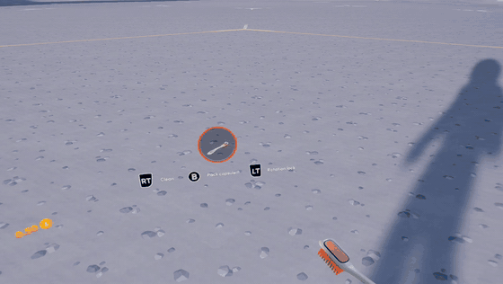

# Moon Sweepers VR



*[Watch the full clip with sound](media/gameplay.mp4)*

Play **Moon Sweepers** (Steam) in PC VR with head tracking and motion controls.

- Stereo 3D with full head tracking (look and lean)
- **Quest / Touch motion controllers:** sweep where your right hand points, the tool is held in your hand, and you point at items and machines to use them
- **Laser pointer** from the right hand when you're not sweeping, with adjustable colour and brightness
- **Moon map with the laser:** point at the map to move its cursor and press A to select; the station teleport buttons work too. The laser turns bright yellow on the map and switches itself on while the map is open
- **Wrist HUD:** dust/inventory, money and notices sit on your left wrist; the tool belt stays at the bottom of your view and the compass at the top
- Menus float in front of you (main and pause menus further back); the field manual and the new-hire contract display properly
- HUD can be hidden completely; the screen shading, vignette, motion blur and brush reticle are removed for comfort
- Works anywhere on the Moon, including the far side
- Xbox / PlayStation controllers also work, at the same time
- **Thumb-rest D-pad:** rest your right thumb on the thumb rest and the left stick works as the D-pad
- In-game recenter and height adjustment

Built on [UUVR](https://github.com/Raicuparta/uuvr) and [BepInEx](https://github.com/BepInEx/BepInEx), plus a custom plugin (this repo) that makes them work on the game's Unity 6 engine.

> ☕ **Enjoying the mod?** It's free, and always will be. If you'd like to say thanks, you can
> [buy me a coffee](https://buymeacoffee.com/VEEERRR). It's never expected, but it's always hugely appreciated. Thank you!

> Tested on Moon Sweepers 1.0.5 with a Meta Quest 3S through SteamVR. Other headsets get head tracking and gamepad play; their motion controller buttons are untested. A game update may break the mod until it is updated. Play solo: mods and multiplayer don't mix well.

## Requirements

- Moon Sweepers on Steam (Windows)
- A PC VR headset and **SteamVR**
- A free [Nexus Mods](https://www.nexusmods.com/) account, to download the
  [MoonSweepers BepInEx Patcher](https://www.nexusmods.com/moonsweepers/mods/9) by boverson777.
  That patcher is someone else's work and is **not included** here; the installer walks you through getting it.

## Install

1. Download `MoonSweepersVR-<version>.zip` from [Releases](../../releases) and **extract the whole zip** (e.g. to your Desktop).
2. Close the game, then double-click **`Install.bat`**. If Windows shows "Windows protected your PC", click *More info* > *Run anyway*.

The installer:

1. Finds Moon Sweepers in your Steam library (or asks for the folder) and backs up your save.
2. Downloads **BepInEx 6.0.0-be.791** from the official BepInEx build server.
3. Checks for the **MoonSweepers BepInEx Patcher**. If it isn't installed or already in your Downloads folder, it opens the patcher's Nexus Mods page. You log in, click *Manual download* (then *Slow download*), and the installer spots the file when it lands in Downloads and carries on by itself.
4. Checks that the patcher installed correctly (version 1.0.2).
5. Downloads **UUVR** from Raicuparta's GitHub releases.
6. Installs the VR plugin, its settings and the Quest controller layout.

Every download is checked against the exact file the mod was tested with (SHA-256). Offline? Put the files in your Downloads folder first and the installer will use them. A log of each run is saved as `install-log.txt` next to `Install.bat`.

Then: **start SteamVR first**, then launch Moon Sweepers from Steam. The first launch takes a minute or two longer while BepInEx prepares the game.

### Installing by hand

1. Extract [BepInEx-Unity.IL2CPP-win-x64-6.0.0-be.791](https://builds.bepinex.dev/projects/bepinex_be) into the game folder (next to `MoonSweepers.exe`).
2. Put `MoonSweepers.ModEngine.dll` from the [Nexus patcher](https://www.nexusmods.com/moonsweepers/mods/9) in `BepInEx\patchers\MoonSweepers.ModEngine\`.
3. From [UUVR](https://github.com/Raicuparta/uuvr/releases)'s `uuvr-il2cpp-legacy.zip`, copy `patchers\*` to `BepInEx\patchers\uuvr-il2cpp-legacy\` and `plugins\*` to `BepInEx\plugins\uuvr-il2cpp-legacy\`.
4. From the release zip's `files\mod` folder: copy `BepInEx\` into the game folder, and copy `SteamVR\bindings_oculus_touch.json` into `BepInEx\patchers\uuvr-il2cpp-legacy\CopyToGame\Data\StreamingAssets\SteamVR\`.

## Controls

**Quest / Touch controllers**

| Input | Does |
|---|---|
| Point right hand | Aim the tool, highlight items and machines (laser shows where) |
| Left stick | Move |
| Right thumb on the thumb rest + left stick | D-pad |
| Right stick | Turn and look up / down |
| Triggers | LT / RT (right trigger sweeps) |
| Grips | LB / RB |
| A, B, X, Y | A, B, X, Y (A = jump) |
| Right grip + B / Left grip + Y | Start / Select |
| Both grips + A (or click both sticks) | Recenter the view |
| Both grips + right stick up / down | Raise / lower your view |
| Both grips + X | Laser on / off |
| Both grips + right stick left / right | Laser colour (yellow, blue, red, green, white) |
| Both grips + left stick left / right | Laser brightness |
| Both grips + left stick up / down | Held-tool height (gamepad play) |
| Both grips + click left stick | Hide / show the HUD |

On the tool upgrade / supply wall screen the left stick steps through items.

On the **moon map**, point the laser at the map or a teleport station and press **A** to select.

**Xbox / PlayStation controller**

| Input | Does |
|---|---|
| LB + RB + A (or click both sticks) | Recenter |
| LB + RB + D-pad up / down | View height |
| LB + RB + D-pad right / left | Tool height |
| LB + RB + X | Laser on / off |
| LB + RB + Y | Laser colour |
| LB + RB + click left stick | Hide / show the HUD |

Keyboard: F9 recenter, F11 / F10 view height.

## Settings

`BepInEx\config\claude.moonxrstarter.cfg` (edit with the game closed). Highlights:

| Section | Setting | What it does |
|---|---|---|
| `[Head Tracking]` | Height Offset, Tool Height Offset | View and tool height (also adjustable in game) |
| `[Motion Controls]` | Enabled, Hand Interaction | Motion controls on/off; point-to-use on/off |
| `[Motion Controls]` | Laser Pointer, Laser Colour, Laser Brightness, Laser Length | Laser options |
| `[Motion Controls]` | Thumb Rest D-pad | Left stick becomes the D-pad while your right thumb is on the thumb rest |
| `[Motion Controls]` | Hide Reticle | Hide the brush reticle (cleaning still works) |
| `[Hand HUD]` | Hand, Width, Height Above Hand | Wrist HUD on `Left`, `Right` or `Off`, its size and height |
| `[VR UI]` | Distance, Width, Height Offset | Menu panel placement |
| `[VR UI]` | Main Menu Distance | How far back the main and pause menus sit |
| `[VR UI]` | Compass Size / Raise, Tool Belt Size / Lower | Size and position of the compass and tool belt |
| `[VR UI]` | Map Width, Teleport Panel Size | Moon map size; optionally show the teleport list as its own bigger panel |
| `[VR UI]` | Hide HUD | Hide the HUD (also toggled in game) |
| `[VR UI]` | Field Manual Width, Field Manual Zoom Out, Field Manual Face On | Field manual panel |
| `[Comfort]` | Disable Motion Blur, Disable Vignette | Comfort tweaks |

## Troubleshooting

- **Game on the monitor but not in the headset:** SteamVR wasn't running before the game started.
- **Motion controller buttons do nothing:** SteamVR > Settings > Controllers > Manage controller bindings > Moon Sweepers > choose the default binding.
- **Highlighting or prompts behave oddly:** set `Hand Interaction = false` under `[Motion Controls]`.
- **Wrist HUD in the way:** set `Hand = Off` under `[Hand HUD]` to put the HUD back in front of you.
- **No mods load:** `BepInEx\LogOutput.log` should contain `Chainloader startup complete`. If it doesn't, check the patcher is in `BepInEx\patchers\MoonSweepers.ModEngine\`.

## Uninstall

Delete `BepInEx`, `dotnet`, `winhttp.dll`, `doorstop_config.ini` and `.doorstop_version` from the game folder, then in Steam: *Properties > Installed Files > Verify integrity of game files*.

## Building from source

Needs the [.NET 6 SDK](https://dotnet.microsoft.com/download/dotnet/6.0) and a Moon Sweepers install that already has BepInEx and the patcher and has been launched once.

```
cd src
dotnet build -c Release -p:GameDir="C:\Program Files (x86)\Steam\steamapps\common\Moon Sweepers"
```

### Release zip layout

```
Install.bat
README.txt
files\install.ps1
files\mod\BepInEx\plugins\MoonXrStarter\MoonXrStarter.dll
files\mod\BepInEx\config\claude.moonxrstarter.cfg
files\mod\BepInEx\config\raicuparta.uuvr-legacy.cfg
files\mod\SteamVR\bindings_oculus_touch.json
```

Source files: `Plugin.cs` (settings, starts OpenVR), `HeadTracking.cs`, `UiToWorld.cs` (menus/HUD panels), `HudLayout.cs` (wrist HUD), `MotionControls.cs` + `XrPadSource.cs` + `VirtualPad.cs` (controllers), `Laser.cs`, `MenuFix.cs` (supply-wall navigation), `Comfort.cs` (blur/vignette, image cameras), `ManualView.cs` (field manual framing), `ScreenProbe.cs` (diagnostics).

`Install.bat` comes from `installer\`, `files\install.ps1` from `installer\install.ps1`, and `files\mod` from `mod\` plus the built DLL. If you update a dependency, update its URL and SHA-256 at the top of `install.ps1`.

## Credits and licences

- **This project:** MIT (see [LICENSE](LICENSE)).
- **[UUVR](https://github.com/Raicuparta/uuvr)** by Raicuparta, GPL-3.0. Downloaded by the installer from its official releases; not included.
- **[BepInEx](https://github.com/BepInEx/BepInEx)**, LGPL-2.1. Downloaded by the installer from builds.bepinex.dev; not included.
- **[MoonSweepers BepInEx Patcher](https://www.nexusmods.com/moonsweepers/mods/9)** by boverson777. Not included or re-hosted: users download it from Nexus Mods themselves. Please endorse it there.

## Support

If this mod made your day a bit better, please consider [buying me a coffee](https://buymeacoffee.com/VEEERRR). Thank you!

Not affiliated with or endorsed by the Moon Sweepers developers.
